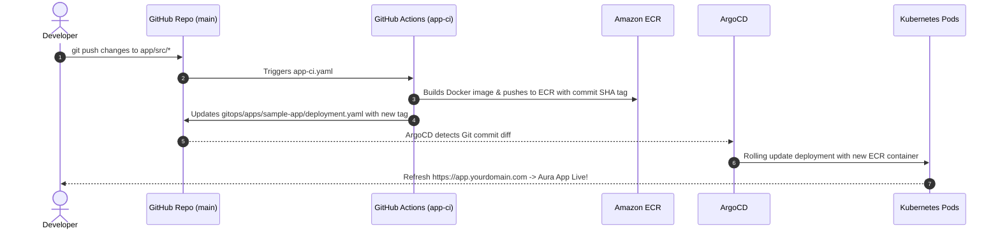

# End-to-End GitOps with Terraform, Amazon EKS, ArgoCD & GitHub Actions

Production-grade GitOps repository deploying a full microservices platform on **Amazon EKS (ap-south-1 Mumbai)** with **ArgoCD**, **AWS Load Balancer Controller**, **ExternalDNS**, **Route 53**, and **ACM TLS**, fully driven by **GitHub Actions CI/CD**.

---

## 🏗️ Architecture & High-Level Flow

```mermaid
flowchart TD
    subgraph Developer_Workflows ["Developer & CI/CD Workflow"]
        Dev["Developer"] -->|Push to app/| AppRepo["GitHub: app/**"]
        Dev -->|Push to terraform/| TFRepo["GitHub: terraform/**"]
        AppRepo -->|Trigger| GHA_App["GitHub Actions (app-ci.yaml)"]
        TFRepo -->|PR / Merge| GHA_TF["GitHub Actions (terraform.yaml)"]
        GHA_TF -->|Terraform Apply| AWS_Cloud["AWS Infrastructure (ap-south-1)"]
        GHA_App -->|1. Build & Push Image| ECR["Amazon ECR"]
        GHA_App -->|2. Update Image Tag| GitOps["gitops/apps/sample-app/deployment.yaml"]
    end

    subgraph AWS_EKS ["Amazon EKS Cluster (ap-south-1)"]
        ArgoCD["ArgoCD Controller"] -->|Watches GitOps Repo| GitOps
        ArgoCD -->|Syncs Manifests| Pods["Sample App Pods (ReplicaSet)"]
        ALB_Controller["AWS Load Balancer Controller"] -->|Discovers Ingress| ALB["AWS Application Load Balancer"]
        ExtDNS["ExternalDNS"] -->|Reads Hostname| R53["AWS Route 53 Hosted Zone"]
    end

    subgraph Internet_Traffic ["Public Traffic Flow"]
        Client["Browser User: https://app.yourdomain.com"] -->|DNS Query| R53
        R53 -->|Resolves DualStack Alias| ALB
        ALB -->|Terminates TLS with ACM| ALB
        ALB -->|Routes HTTP Traffic (Target Type: IP)| Pods
    end
```

---

## 📂 Repository Structure

```
├── README.md                               # Complete setup, testing flow & teardown guide
├── .gitignore                              # Ignores .terraform/, *.tfstate, *.tfvars
│
├── .github/
│   └── workflows/
│       ├── terraform.yaml                  # Stage 5: Plan on PR, apply on merge (Access Key auth)
│       └── app-ci.yaml                     # Stage 6: Docker build -> ECR push -> GitOps tag update
│
├── terraform/
│   ├── base/                               # Stage 1: Network Layer
│   │   ├── backend-staging.hcl             # S3 remote state configuration (ap-south-1)
│   │   ├── provider.tf                     # AWS provider (~> 5.0)
│   │   ├── main.tf                         # Base root coordinator
│   │   ├── locals.tf                       # Tags and cluster identifiers
│   │   ├── variables.tf                    # VPC CIDR, subnets, region
│   │   ├── vpc.tf                          # Module instantiation
│   │   ├── outputs.tf                      # vpc_id, public/private subnets, security_group_id
│   │   └── modules/
│   │       ├── VPC/                        # VPC, IGW, NAT Gateway, Route Tables, Subnets
│   │       │   ├── main.tf
│   │       │   ├── igw.tf
│   │       │   ├── subnet.tf
│   │       │   ├── variables.tf
│   │       │   └── outputs.tf
│   │       └── SecurityGroup/              # Base security groups with ingress/egress rules
│   │           ├── main.tf
│   │           ├── variables.tf
│   │           └── outputs.tf
│   │
│   └── infra/                              # Stages 2 & 3: Platform Layer
│       ├── backend-staging.hcl             # S3 remote state configuration (ap-south-1)
│       ├── provider.tf                     # AWS, Kubernetes, Helm, and TLS providers
│       ├── main.tf                         # Platform coordinator
│       ├── data.tf                         # Reads outputs from base layer remote state
│       ├── variables.tf                    # Domain, region, node types, cluster name
│       ├── terraform.tfvars                # Configuration values
│       ├── outputs.tf                      # Nameservers, cluster endpoint, IAM role ARNs
│       ├── eks.tf                          # EKS Cluster (1.30) & Managed Node Groups
│       ├── ecr.tf                          # ECR Repository with lifecycle rules
│       ├── route53.tf                      # Route 53 Public Hosted Zone
│       ├── acm.tf                          # Public ACM SSL/TLS wildcard certificate (*.domain.com)
│       ├── iam.tf                          # IRSA roles (ALB Controller & ExternalDNS)
│       ├── helm-release.tf                 # Stage 3: Deploys ArgoCD via Helm
│       ├── modules/
│       │   ├── ECR/                        # ECR repository module
│       │   │   ├── main.tf
│       │   │   ├── variables.tf
│       │   │   └── outputs.tf
│       │   ├── Route53/                    # Route 53 hosted zone module
│       │   │   ├── main.tf
│       │   │   ├── variables.tf
│       │   │   └── outputs.tf
│       │   └── iam-role-for-service-accounts-eks/ # OIDC federated IAM role for Kubernetes SA
│       │       ├── main.tf
│       │       ├── policies.tf             # ALB Controller & ExternalDNS official policies
│       │       ├── variables.tf
│       │       └── outputs.tf
│       └── charts/
│           └── argocd/                     # Stage 3: Wrapper Helm chart
│               ├── Chart.yaml              # Chart wrapper declaring argo-cd dependency
│               ├── values.yaml             # Base values
│               └── envs/
│                   └── staging/
│                       └── values.yaml     # Staging overrides (insecure mode, resource limits)
│
├── gitops/                                 # Stage 4: ArgoCD App-of-Apps Declarative State
│   ├── root-app.yaml                       # The Root Application applied to EKS
│   └── apps/
│       ├── aws-load-balancer-controller/
│       │   └── application.yaml            # ArgoCD Application deploying AWS ALB Controller
│       ├── external-dns/
│       │   └── application.yaml            # ArgoCD Application deploying ExternalDNS
│       └── sample-app/
│           ├── application.yaml            # ArgoCD Application deploying the sample app
│           ├── deployment.yaml             # Deployment (nginx first, updated by CI)
│           ├── service.yaml                # ClusterIP service on port 80
│           └── ingress.yaml                # ALB Ingress pointing to app.yourdomain.com
│
└── app/                                    # Stage 6: The Application Source Code
    ├── Dockerfile                          # Multi-stage optimized Nginx container
    └── src/
        ├── index.html                      # Aura productivity app frontend
        ├── style.css
        └── app.js
```

---

## 🚀 Step-by-Step Testing Flow (Stage 0 to Stage 7)

### Stage 0: One-Time Preparation

#### 1. Configure AWS CLI & Verify Credentials
This project uses **ap-south-1** (Mumbai) and standard **AWS Access Key & Secret Key**:
```powershell
aws configure
# AWS Access Key ID: <YOUR_ACCESS_KEY>
# AWS Secret Access Key: <YOUR_SECRET_KEY>
# Default region name: ap-south-1
# Default output format: json

# Verify your IAM identity:
aws sts get-caller-identity
```

#### 2. Create S3 Remote State Bucket (ap-south-1)
Terraform states require an S3 bucket with versioning enabled:
```powershell
$BUCKET_NAME = "eks-gitops-tfstate-715844024336"

aws s3api create-bucket `
  --bucket $BUCKET_NAME `
  --region ap-south-1 `
  --create-bucket-configuration LocationConstraint=ap-south-1

aws s3api put-bucket-versioning `
  --bucket $BUCKET_NAME `
  --versioning-configuration Status=Enabled
```

#### 3. Set an AWS Budget Alert
Avoid unexpected bills by setting a $10 budget in AWS Console:
- Go to **AWS Budgets** -> **Create budget** -> **Cost budget**.
- Set monthly budget amount (e.g., `$10.00`) and configure email alerts when actual spend exceeds 80%.

#### 4. Configure GitHub Repository Secrets
Under your GitHub repository (`Settings -> Secrets and variables -> Actions`), add the following secrets:
- `AWS_ACCESS_KEY_ID`: Your AWS Access Key.
- `AWS_SECRET_ACCESS_KEY`: Your AWS Secret Key.
- `AWS_REGION`: `ap-south-1`.

---

### Stage 1: Network Layer (`terraform/base/`)

Create the VPC, 2 public subnets, 2 private subnets, Internet Gateway, NAT Gateway, and security groups.

```powershell
cd terraform/base

# Initialize Terraform with the S3 backend
terraform init -backend-config=backend-staging.hcl

# Review the execution plan
terraform plan

# Apply changes to create the network
terraform apply -auto-approve

cd ../..
```
**Verification:**
```powershell
aws ec2 describe-vpcs --filters "Name=tag:Project,Values=eks-gitops" --region ap-south-1
```
*Result: An isolated, highly-available VPC with Kubernetes subnet tags exists in AWS.*

---

### Stage 2: Platform Layer (`terraform/infra/`)

Deploys the EKS cluster, managed worker node group, ECR repository, Route 53 hosted zone, ACM wildcard certificate, and IRSA roles.

```powershell
cd terraform/infra

# 1. Update terraform.tfvars with your registered domain name:
# domain_name = "yourdomain.com"

# 2. Initialize with remote backend
terraform init -backend-config=backend-staging.hcl

# 3. Apply infrastructure (EKS provisioning takes 10 to 15 minutes)
terraform apply -target=aws_eks_cluster.this -target=aws_eks_node_group.this -target=module.route53 -target=aws_acm_certificate.this -auto-approve
```

#### Route 53 Nameserver Delegation (Crucial Step):
From the Terraform output, copy the 4 nameservers shown:
```powershell
terraform output route53_nameservers
```
Go to your **Domain Registrar** (GoDaddy, Namecheap, Cloudflare, etc.) and replace your domain's default NS records with these 4 Route 53 nameservers.
*The ACM certificate validation and public website access cannot complete until DNS delegation resolves to Route 53.*

#### Configure kubectl:
```powershell
aws eks update-kubeconfig --region ap-south-1 --name eks-gitops-staging

# Check that worker nodes are ready:
kubectl get nodes
```
*Result: A fully operational EKS cluster and nodes communicating with your local kubectl.*

---

### Stage 3: ArgoCD via Helm

Deploy ArgoCD into the EKS cluster using the staging configurations:

```powershell
# From terraform/infra:
terraform apply -target=helm_release.argocd -auto-approve

# Check ArgoCD pods:
kubectl get pods -n argocd -w
```
Wait until all ArgoCD pods (`argocd-server`, `argocd-repo-server`, `argocd-application-controller`) show `Running`.

#### Retrieve ArgoCD Admin Password:
```powershell
$encoded = kubectl -n argocd get secret argocd-initial-admin-secret -o jsonpath="{.data.password}"
[System.Text.Encoding]::UTF8.GetString([System.Convert]::FromBase64String($encoded))
```

#### Access ArgoCD Dashboard locally:
```powershell
kubectl port-forward svc/argocd-server -n argocd 8080:443
```
Open [https://localhost:8080](https://localhost:8080) in your browser (Username: `admin`, Password: output from above command).

---

### Stage 4: Deploy GitOps Menu (`gitops/root-app.yaml`)

Stage 4 connects ArgoCD to your Git repository using the **App-of-Apps** pattern.

```powershell
# 1. Check your IAM role outputs from terraform:
cd terraform/infra
terraform output load_balancer_controller_role_arn
terraform output external_dns_role_arn
cd ../..

# 2. Verify gitops/apps/aws-load-balancer-controller/application.yaml and external-dns/application.yaml
# have the correct role-arn values (matches account 715844024336).

# 3. Apply the root app to ArgoCD:
kubectl apply -f gitops/root-app.yaml
```

**What ArgoCD does automatically:**
1. Syncs `root-app`.
2. Discovers `aws-load-balancer-controller` and installs it in `kube-system`.
3. Discovers `external-dns` and installs it in `external-dns`.
4. Discovers `sample-app` and installs the deployment, service, and ingress in `sample-app`.
5. AWS Load Balancer Controller provisions an AWS Application Load Balancer (ALB).
6. ExternalDNS creates the Route 53 `A` record pointing `app.yourdomain.com` to the ALB DNS name.
7. Browse to `https://app.yourdomain.com` - the initial Nginx placeholder page opens with valid SSL!

---

### Stage 5: GitHub Actions for Terraform

The `.github/workflows/terraform.yaml` workflow automates infrastructure changes:
- **Pull Request**: Automatically triggers `terraform fmt -check`, `terraform init`, and `terraform plan` for both `base` and `infra`.
- **Merge to `main`**: Automatically triggers `terraform apply -auto-approve`.

**Testing Stage 5:**
1. Create a git branch: `git checkout -b feature/tf-update`
2. Make a minor tag update in `terraform/infra/variables.tf`.
3. Commit and push: `git push origin feature/tf-update`
4. Open a Pull Request on GitHub.
5. Inspect the GitHub Actions tab to view the live `terraform plan`.
6. Merge the PR; GitHub Actions applies the change to AWS.

---

### Stage 6: Your Own Application CI/CD

The `.github/workflows/app-ci.yaml` workflow automates application updates:



**Testing Stage 6:**
1. Make a visible change in `app/src/index.html` (e.g. edit header or title).
2. Commit and push to `main`:
   ```powershell
   git add app/
   git commit -m "feat(app): update frontend branding"
   git push origin main
   ```
3. Watch the GitHub Actions run:
   - Authenticates to AWS via Access Keys in `ap-south-1`.
   - Builds the Docker image from `app/Dockerfile`.
   - Pushes `715844024336.dkr.ecr.ap-south-1.amazonaws.com/eks-gitops-sample-app:<SHA>`.
   - Updates `gitops/apps/sample-app/deployment.yaml`.
   - Commits back to GitHub.
4. ArgoCD detects the change within 3 minutes (or click **Sync** in ArgoCD UI for instant sync).
5. Refresh `https://app.yourdomain.com` - your custom **Aura** web application is live!

---

### Stage 7: Clean-Up Order (Cost Management)

> [!WARNING]
> EKS clusters and ALBs incur hourly AWS costs (~$0.20–$0.24/hour). To prevent unnecessary charges, always tear down resources in the strict order below.

#### Step 1: Delete Kubernetes Ingress & ArgoCD Applications
Deleting the Ingress first allows the AWS Load Balancer Controller to safely delete the AWS ALB:
```powershell
# Delete the Ingress and Root Application
kubectl delete -f gitops/apps/sample-app/ingress.yaml
kubectl delete -f gitops/root-app.yaml

# Wait 2 minutes for the AWS Load Balancer to delete:
aws elbv2 describe-load-balancers --region ap-south-1 --query "LoadBalancers[*].LoadBalancerName"
```

#### Step 2: Destroy Infra Layer (EKS, ECR, Route 53, Helm)
```powershell
cd terraform/infra
terraform destroy -auto-approve
cd ../..
```

#### Step 3: Destroy Base Layer (VPC, NAT Gateway, Subnets)
```powershell
cd terraform/base
terraform destroy -auto-approve
cd ../..
```

#### Step 4: Optional State Bucket Cleanup
If you wish to remove the S3 state bucket:
```powershell
aws s3 rb s3://eks-gitops-tfstate-715844024336 --force
```

---

## 🔐 Credentials & Security Summary

| Setting | Value / Source |
|---|---|
| **AWS Region** | `ap-south-1` (Mumbai) |
| **AWS Account ID** | `715844024336` |
| **IAM User** | `arn:aws:iam::715844024336:user/kub-sf` |
| **Local Auth** | `~/.aws/credentials` (`aws configure`) |
| **GitHub Actions Auth** | `AWS_ACCESS_KEY_ID`, `AWS_SECRET_ACCESS_KEY` in GitHub Secrets |
| **Pod IAM Roles** | AWS IAM Roles for Service Accounts (IRSA) via OIDC Federation |
| **Secrets in Git** | Strictly excluded via `.gitignore` (`.tfstate`, `.tfvars`, credentials) |

